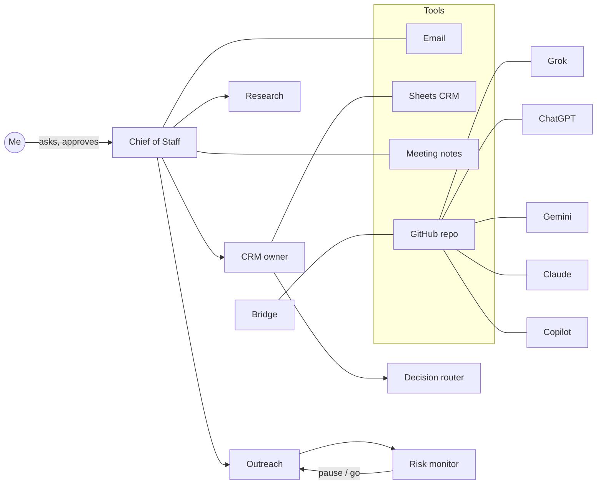

# AI-Native Ops: how I run a founder's office with a team of AI agents

I'm Raghav R, VP – Founder's Office at Ai Accountant (Y Combinator-backed). I run sales, GTM and ops
for our restaurant and CA-partnership lines with a team of specialised AI agents. Each agent has one job,
shares memory with the others, and works under one rule: **AI drafts, a human approves**.

This repo describes that setup. It contains no client data, credentials or internal numbers.

## The agent team

| Agent | Job |
|-------|-----|
| Chief of Staff | Daily plan, meeting prep, end-of-day summary, follow-up drips |
| CRM owner | Keeps the sales pipeline sheet clean; stage rules, nurture and park logic |
| Decision router | Scores, ranks and makes go/skip calls with a stated verdict and confidence |
| Research desk | Company and market research before every meeting |
| Prospect scout | Mines public registries and maps for new leads |
| Outreach | Drafts LinkedIn and email outreach in my voice |
| Risk monitor | Watches LinkedIn and email for account-risk signals and pauses outreach |
| Accounting assistant | Extracts documents and reviews workbooks; posts only after explicit approval |
| Mentor | Blunt review of how I run projects; no pep talk |
| X scout | Tracks tools and conversations on X |
| Ideas | Holds new product and GTM ideas |
| Bridge | Keeps every AI platform working from one shared repo |

## How it fits together

## Key systems

### Parallel research layer
A Research agent and a Prospect scout use Parallel (web search, entity discovery, enrichment and deep
research) to find multi-outlet restaurant brands, their head offices and founders, live outlet counts on
delivery platforms, and public candidate profiles for hiring. The decision router gives a verdict and
confidence on each go/skip. I decide who gets contacted. Results land in a Google Sheets CRM run by its
own agent, which tracks 42 firms as of October 2026.

### Email follow-up engine
Every lead I email goes on a three-step follow-up drip, one step every three working days: a worked
payout-mismatch example, then a free one-outlet trial offer, then a final check-in. A weekday routine
checks the CRM and inbox and stops the drip the moment a lead replies. Agents draft every email and log it
in the CRM. I review and send each one myself; nothing goes out automatically.

### Social listening and building in public
- **Complaint-to-lead:** public posts from restaurants complaining about delivery-platform payouts become
  leads. The decision router gives a go/skip on whether each one enters an outreach drip.
- **Build in public:** from 20 Oct 2026, a clearly labelled automated X account posts three times a week about this agent
  setup, using images made from real dashboards. It only replies to people who engage first and never
  auto-likes or follows. Every post is scored by the decision router and checked by the Risk agent before
  it goes out. I write my own weekly LinkedIn post.

### Decision router in numbers
Every ranking, routing and go/skip call is saved as a run file with its verdict and confidence. A weekly
review sends calls under 0.5 confidence to me. In the week of 12 Oct 2026 it handled 446 decision calls; 122 came in under 0.5 confidence and went to a human.

## Operating rules

1. **Human in the loop.** Agents draft emails, messages, posts and pushes. Nothing goes out without my yes.
2. **One job per agent.** Narrow agents beat one generalist. They hand off through shared memory.
3. **Decisions are scored.** Ranking, routing and go/skip calls go through a decision agent that
   records its verdict and confidence next to the output, so I can audit it later.
4. **Rules are written down.** Pipeline stages, follow-up cadences and park rules live as standing
   instructions, not in someone's head.
5. **Recurring work is scheduled.** Daily updates, follow-up drips and monitors run as routines.
6. **One shared workspace across AIs.** Grok, ChatGPT, Gemini, Claude and Copilot read and write the
   same private repo (`AGENTS.md`, `STATE.md`, `HANDOFF.md`), so context survives switching tools.
7. **Secrets never live in files.** Access is by OAuth, limited to the repos each tool needs, and reviewed quarterly.

## Results so far

- A pipeline of restaurant-chain prospects run end to end by agents: research, outreach drafts,
  follow-up drips, CRM hygiene and meeting prep.
- Daily and weekly partnership updates written automatically from meeting notes and the CRM.
- A risk agent that stops outreach before LinkedIn or email limits put the account at risk.

## Files

- [`AGENTS.md`](AGENTS.md) holds the shared rules every AI follows in my bridged workspace.
- [`HANDOFF-TEMPLATE.md`](HANDOFF-TEMPLATE.md) is the session note format agents use to hand work to each other.

Connect: [LinkedIn](https://www.linkedin.com/in/raghavraja/)
