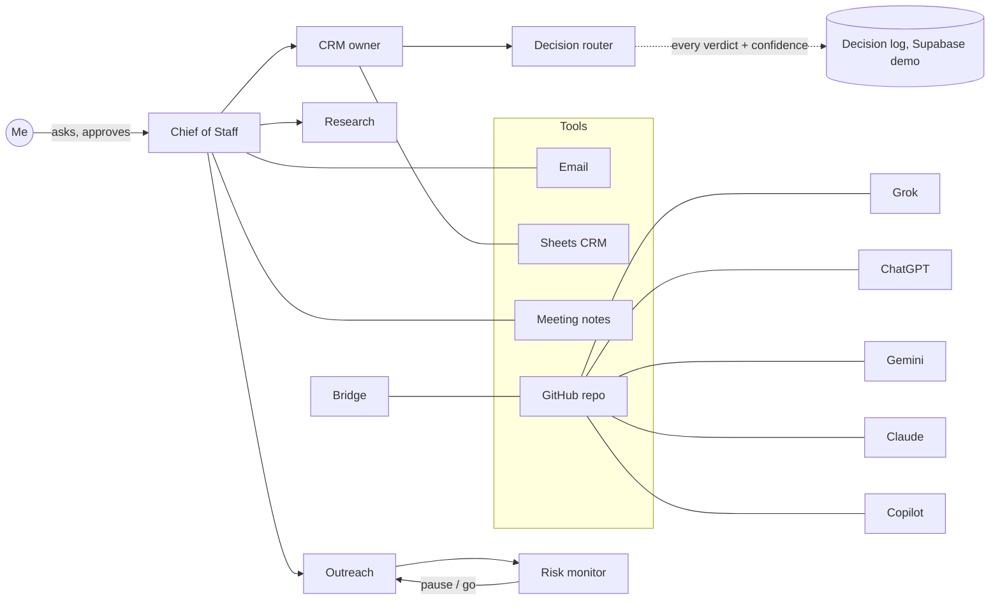

# AI-Native Ops: how I run a founder's office with a team of AI agents

I'm Raghav R, VP – Founder's Office at Ai Accountant (Y Combinator-backed). I run sales, GTM and ops
for our restaurant and CA-partnership lines with a team of specialised AI agents. Each agent has one job,
shares memory with the others, and works under one rule: **AI drafts, a human approves**.

This repo describes that setup. It contains no client data, credentials or internal numbers.

## The agent team

| Agent | Job |
|-------|-----|
| Chief of Staff | Daily plan, meeting prep, end-of-day summary, follow-up drips |
| CRM owner | Keeps the sales pipeline sheet clean; stage rules, nurture and park logic |
| Decision router | Scores, ranks and makes go/skip calls with a stated verdict and confidence |
| Research desk | Company and market research before every meeting |
| Prospect scout | Mines public registries and maps for new leads |
| Outreach | Drafts LinkedIn and email outreach in my voice |
| Risk monitor | Watches LinkedIn and email for account-risk signals and pauses outreach |
| Accounting assistant | Extracts documents and reviews workbooks; posts only after explicit approval |
| Mentor | Blunt review of how I run projects; no pep talk |
| X scout | Tracks tools and conversations on X |
| Ideas | Holds new product and GTM ideas |
| Bridge | Keeps every AI platform working from one shared repo |

## How it fits together

## Key systems

### Parallel research layer
A Research agent and a Prospect scout use Parallel (web search, entity discovery, enrichment and deep
research) to find multi-outlet restaurant brands, their head offices and founders, live outlet counts on
delivery platforms, and public candidate profiles for hiring. The decision router gives a verdict and
confidence on each go/skip. I decide who gets contacted. Results land in a Google Sheets CRM run by its
own agent, which tracks 42 firms as of October 2026.

### Email follow-up engine
Every lead I email goes on a three-step follow-up drip, one step every three working days: a worked
payout-mismatch example, then a free one-outlet trial offer, then a final check-in. A weekday routine
checks the CRM and inbox and stops the drip the moment a lead replies. Agents draft every email and log it
in the CRM. I review and send each one myself; nothing goes out automatically.

### Social listening and building in public
- **Complaint-to-lead:** public posts from restaurants complaining about delivery-platform payouts become
  leads. The decision router gives a go/skip on whether each one enters an outreach drip.
- **Build in public:** from 20 Oct 2026, a clearly labelled automated X account posts three times a week about this agent
  setup, using images made from real dashboards. It only replies to people who engage first and never
  auto-likes or follows. Every post is scored by the decision router and checked by the Risk agent before
  it goes out. I write my own weekly LinkedIn post.

### Decision router in numbers
Every ranking, routing and go/skip call is saved as a run file with its verdict and confidence. A weekly
review sends calls under 0.5 confidence to me.

- In the week ending 11 Oct 2026 it handled **446 decision calls**. 122 of them came in under 0.5
  confidence and went to a human.
- By area that week: hiring 175, chief of staff 153, routing and field visits 61, sales and ICP fit 40,
  mentor 17.
- 110 logged decision runs (1,375 decisions) between 25 Sep and 19 Oct 2026.
- What I don't have yet: accuracy. Outcomes aren't tracked against verdicts, which is the next thing to
  build (see the Supabase demo below).

### The CRM funnel
The CRM tracked 42 firms on 19 Oct 2026. Of those, about 62% are at the contacted stage, about 21% are
in nurture, about 10% are past a demo (demo done or in a pilot), and
the rest are parked or new. Stage moves follow written rules that the CRM agent applies.

## What runs on a schedule

Each routine has one human checkpoint. Agents prepare; I decide and send.

| Routine | What it does | Human checkpoint |
|---------|--------------|------------------|
| Daily brief | Pulls the CRM, inbox, calendar and yesterday's decisions into one brief | I read it and set the day |
| Morning day card | A short card of the day's calls and meetings | Read only |
| Call cadence | Picks the leads due a call and has the decision router order them | I make every call |
| 3-step email drip | Drafts the next follow-up for each lead that's due; stops on any reply | Drafts only; I send each one |
| Website SEO audits | Crawls our site three times a day and writes an audit | Read only |
| Evening pipeline review | Reconciles the day's lead updates against the CRM | Updates the CRM only; any outreach it suggests is a draft I send |
| Partnership tracking | Tracks our accounting-firm partner channel, plus a weekly review | Any message to a partner is a draft I send |
| Lead reminders | Weekly and one-off dated nudges for leads that need a touch | I decide whether and how to follow up |
| Build-in-public posts | Drafts posts for the labelled automated X account | Every post is scored by the decision router and checked by the risk agent first |

## One lead, end to end

A large multi-outlet dessert chain, anonymised. This is the strongest single run through the system so
far.

1. **Referral list.** A referral partner shares a list of brands. *(Typical flow.)*
2. **Research and scouting.** The research agent and the scout profile each firm: outlets, legal entity,
   head office, map listings. *(Typical flow.)*
3. **Fit score.** The decision router scores ICP fit. A lead scoring 7.5 or more goes on the route.
4. **13 Oct: first meeting.** Logged to the CRM the same day.
5. **16 Oct: demo with their ops and finance teams.** Meeting notes go into the CRM, and the agents
   draft a pilot offer for me to review.
6. **17 Oct: finance joins.** The CRM agent remaps the stage, and the email drip and call cadence pick up
   the next step on their own.
7. **18 to 19 Oct: pilot pre-mortems.** For the alignment meeting, the decision router scores five
   failure modes for each pilot.

No step sent anything without me. The agents did the research, logging, drafting and scoring in between.

## What broke and what I changed

- **X blocked the agent's browser with a bot check.** I stopped trying to automate the signup. I made
  the account myself, and posting now goes through the official X API on a clearly labelled automated
  account. It only replies to people who engage first. No auto-likes, no auto-follows.
- **Lead data was sometimes wrong.** One outlet count was off by about 9x. Now there's a standing rule: check
  the live outlet count on the delivery platforms before any brief goes out.

## Supabase demo: the decision log

[`supabase-demo/`](supabase-demo/) is a working Postgres version of the decision layer. Every agent
decision becomes a row with its confidence. A generated column flags anything under 0.5 for a human, and a
weekly summary view gives the review its numbers. It's seeded with 1,375 real, anonymised decisions from
the run files (no questions, names or amounts), with row level security and a read-only anonymised
view. It also includes a small supabase-js script that logs a new router response.

## Operating rules

1. **Human in the loop.** Agents draft emails, messages, posts and pushes. Nothing goes out without my yes.
2. **One job per agent.** Narrow agents beat one generalist. They hand off through shared memory.
3. **Decisions are scored.** Ranking, routing and go/skip calls go through a decision agent that
   records its verdict and confidence next to the output, so I can audit it later.
4. **Rules are written down.** Pipeline stages, follow-up cadences and park rules live as standing
   instructions, not in someone's head.
5. **Recurring work is scheduled.** Daily updates, follow-up drips and monitors run as routines.
6. **One shared workspace across AIs.** Grok, ChatGPT, Gemini, Claude and Copilot read and write the
   same private repo (`AGENTS.md`, `STATE.md`, `HANDOFF.md`), so context survives switching tools.
7. **Secrets never live in files.** Access is by OAuth, limited to the repos each tool needs, and reviewed quarterly.

## Results so far

- A pipeline of restaurant-chain prospects run end to end by agents: research, outreach drafts,
  follow-up drips, CRM hygiene and meeting prep (see "One lead, end to end").
- 446 scored decisions in one week, with every low-confidence call routed to me.
- Daily and weekly partnership updates written automatically from meeting notes and the CRM.
- A risk agent that stops outreach before LinkedIn or email limits put the account at risk.

## Files

- [`AGENTS.md`](AGENTS.md) holds the shared rules every AI follows in my bridged workspace.
- [`HANDOFF-TEMPLATE.md`](HANDOFF-TEMPLATE.md) is the session note format agents use to hand work to each other.
- [`supabase-demo/`](supabase-demo/) is the decision log on Supabase: migration, anonymised seed, logging script.

Connect: [LinkedIn](https://www.linkedin.com/in/raghavraja/)
